<p align="center">
  <picture>
    <source media="(prefers-color-scheme: dark)" srcset="docs/brand/logo-dark.png" />
    
  </picture>
</p>

<p align="center">
  <b>Your <a href="https://omarchy.org">Omarchy</a> settings, themes, plugins and apps, the same on every computer.</b><br />
  Private to your own GitHub account. One button, or automatic every 15 minutes.
</p>

<p align="center">
  <a href="https://github.com/tsubaie/OmaSync/actions/workflows/ci.yml"></a>
  <a href="LICENSE"></a>
  
</p>

<p align="center">
  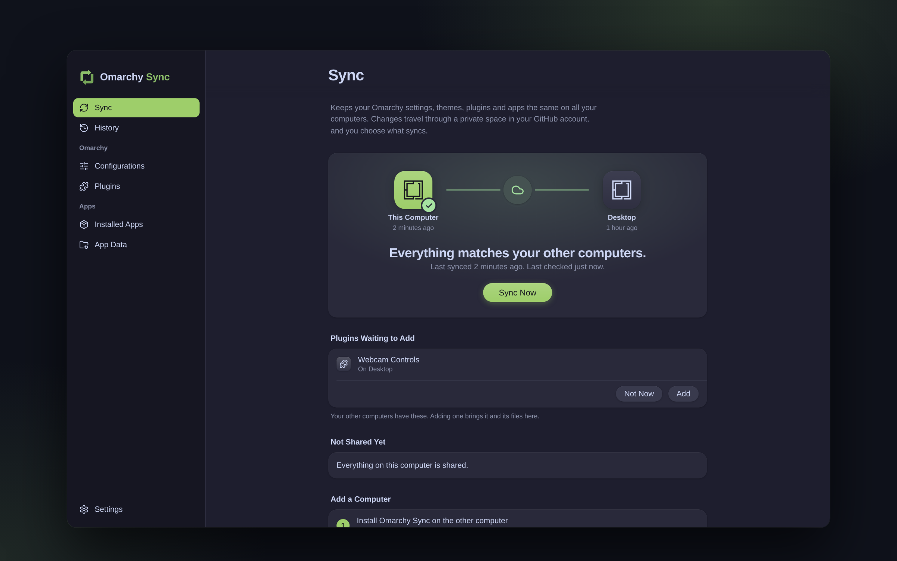
</p>

---

**Contents:** [Why](#why-omarchy-sync) · [Tour](#a-quick-tour) · [Install](#install) · [Getting started](#getting-started) · [Everyday use](#everyday-use) · [What syncs](#what-syncs) · [How it works](#how-it-works) · [Privacy](#privacy-and-safety) · [FAQ](#questions) · [Development](#development)

## Why Omarchy Sync

You set up Omarchy just the way you like it: keyboard shortcuts, a theme, a few plugins, your apps. Then you set up a second computer and do it all again. Omarchy Sync makes your other computers follow along.

- **Your own private space.** Everything travels through a private `omarchy-sync` repository in your own GitHub account. There's no server in between and no new account to create.
- **You choose, item by item.** Keyboard shortcuts, look and feel, night light, menu additions, hooks, web apps, terminals, editors: each has its own switch. Apps and plugins can be on for one computer and off for another.
- **Nothing happens behind your back.** New apps and plugins wait for your yes. You see what's about to arrive before it's applied, and every step of a sync as it happens.
- **Every change can be undone.** History lists each sync with the files it changed, and Undo shows what it will put back before doing it.
- **Made for people, not just terminals.** A native-feeling window that follows your Omarchy theme, with full keyboard and screen reader support.

## A quick tour

<table>
  <tr>
    <td width="50%">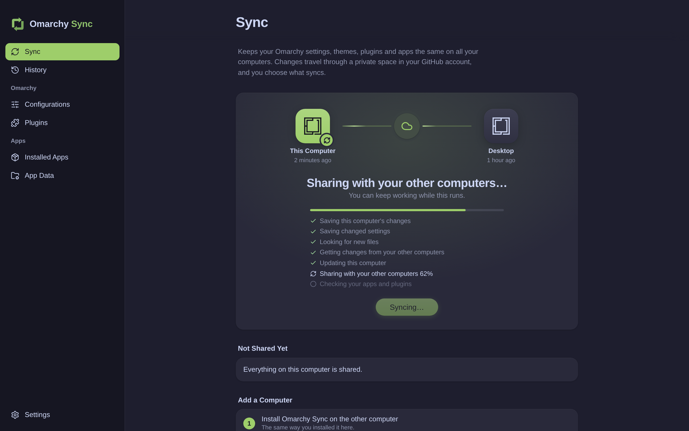</td>
    <td width="50%">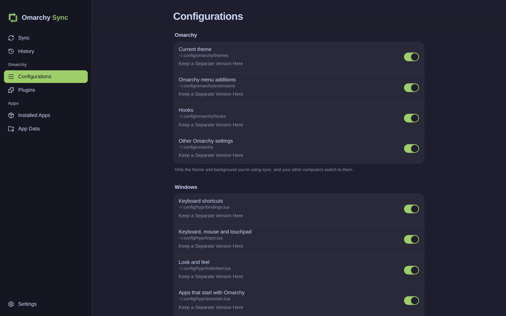</td>
  </tr>
  <tr>
    <td><b>Sync, step by step.</b> Press Sync Now, or let it run every 15 minutes. You see each step, and how far an upload or download has got.</td>
    <td><b>Configurations.</b> Omarchy and window settings, each with its own switch. Only the theme and background you're using sync, and your other computers switch to them.</td>
  </tr>
  <tr>
    <td>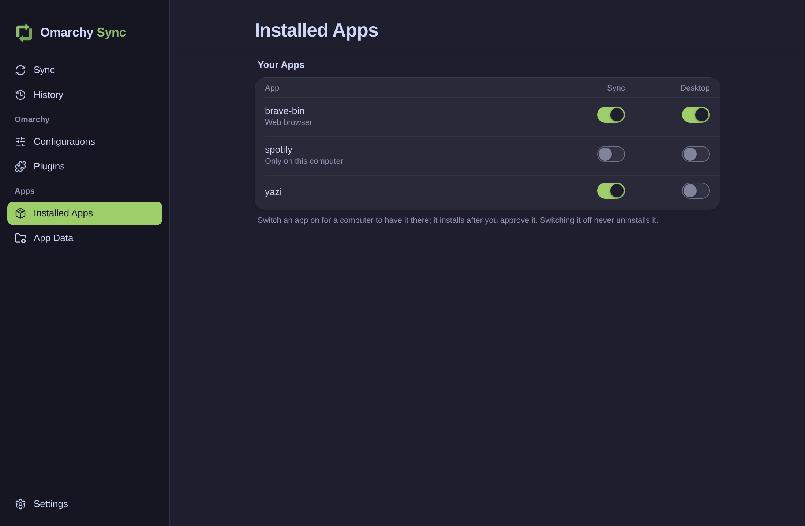</td>
    <td>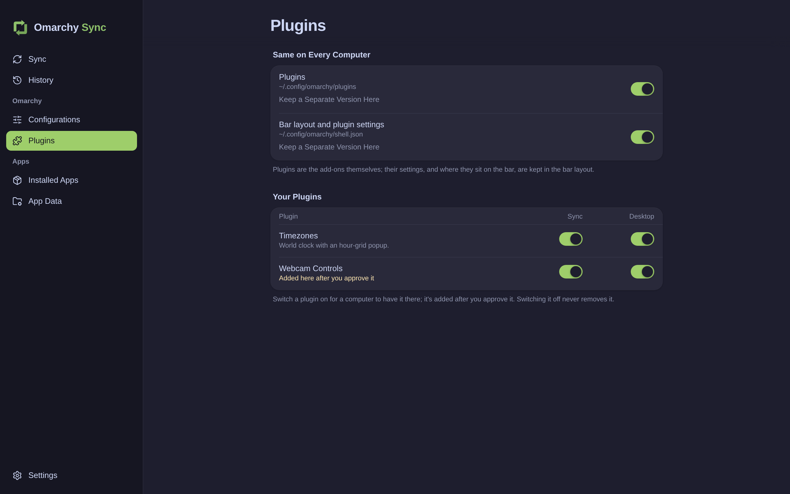</td>
  </tr>
  <tr>
    <td><b>Apps.</b> Choose which apps go on which computer. They install after you approve them, or automatically if you allow it. Switching one off never uninstalls it.</td>
    <td><b>Plugins.</b> Omarchy shell plugins, chosen the same way, plus your bar layout and plugin settings.</td>
  </tr>
  <tr>
    <td>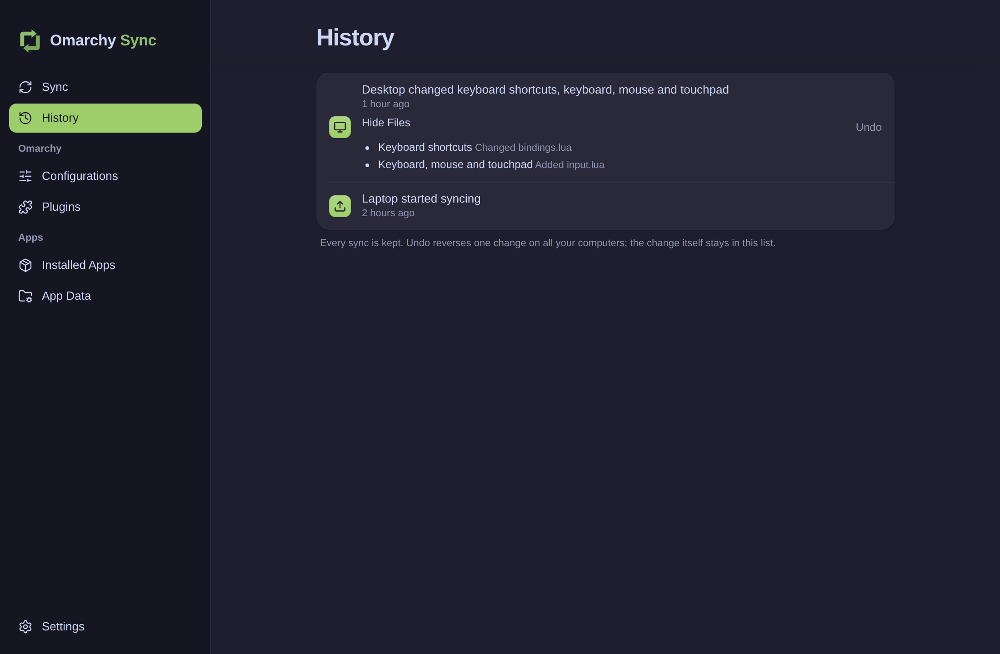</td>
    <td>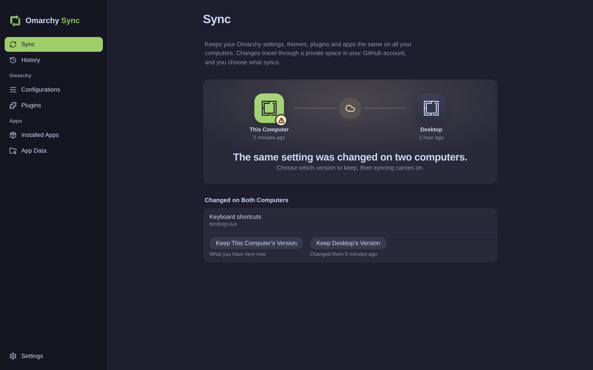</td>
  </tr>
  <tr>
    <td><b>History and Undo.</b> Every sync is kept with the files it changed. Undo lists what it will put back, then does it on all your computers.</td>
    <td><b>When two computers disagree.</b> If the same setting changed on both, you pick which version to keep. Nothing is overwritten without asking.</td>
  </tr>
  <tr>
    <td>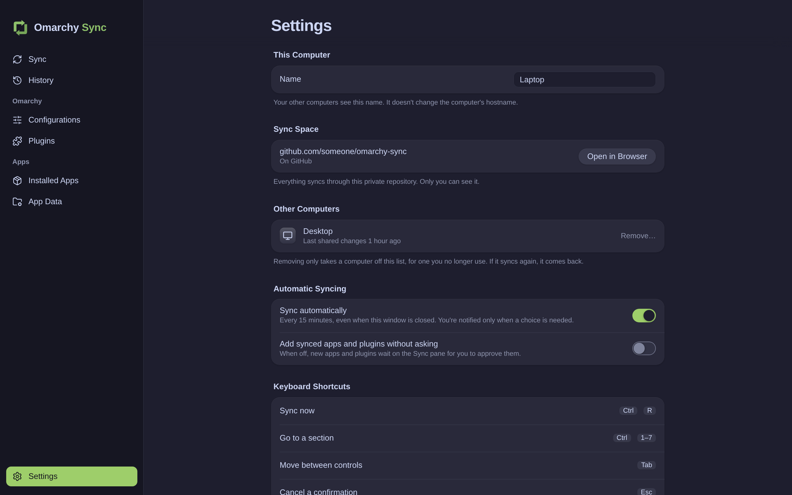</td>
    <td>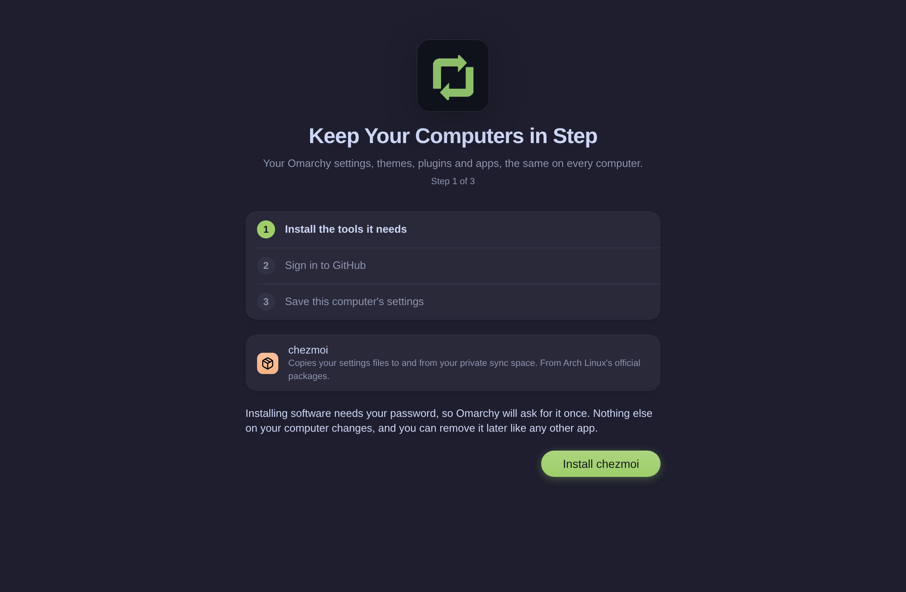</td>
  </tr>
  <tr>
    <td><b>Settings.</b> Name this computer, open your sync space, remove an old computer, and choose automatic syncing.</td>
    <td><b>Three-step setup.</b> Each step says exactly what it will install and do before it does it.</td>
  </tr>
</table>

It follows your Omarchy theme, light or dark:

<p align="center">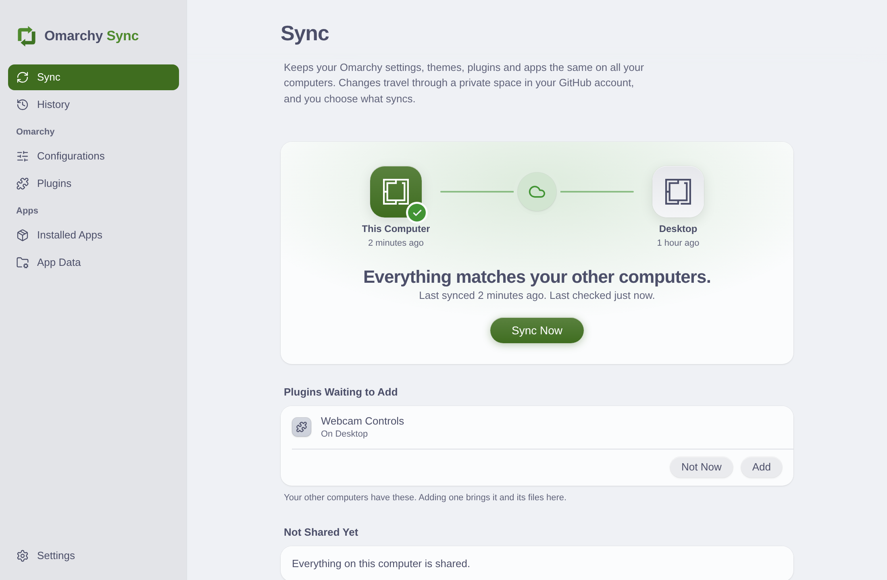</p>

## Install

Omarchy Sync is built from source for now. You need [mise](https://mise.jdx.dev), which Omarchy already includes, and Tauri's system libraries (`webkit2gtk-4.1`, already installed on Omarchy).

```bash
git clone https://github.com/tsubaie/OmaSync.git
cd OmaSync
mise install                      # the Node, pnpm and Rust versions in .mise.toml
mise x -- pnpm install
mise x -- pnpm tauri build --no-bundle
install -Dm755 src-tauri/target/release/omarchy-sync ~/.local/bin/omarchy-sync
install -Dm644 omarchy-sync.desktop ~/.local/share/applications/omarchy-sync.desktop
for size in 16 32 48 64 128 256 512; do
  install -Dm644 packaging/icons/${size}x${size}/omarchy-sync.png \
    ~/.local/share/icons/hicolor/${size}x${size}/apps/omarchy-sync.png
done
```

Then open **Omarchy Sync** from the app launcher (Super + Space).

To update later, pull and run the same build and `install` lines again.

## Getting started

### Your first computer

1. **Install the tools it needs.** Omarchy Sync names each one and what it's for (`chezmoi`, `github-cli` and `git`), then installs them through Omarchy's password prompt.
2. **Sign in to GitHub.** A browser window opens for GitHub's own sign-in. Omarchy Sync never sees your password.
3. **Save this computer's settings.** It creates your private `omarchy-sync` repository and saves this computer's settings into it.

### Every other computer

Install Omarchy Sync, sign in to the **same** GitHub account, and choose **Use My Synced Settings**. Before anything changes, the computer's current settings are backed up to `~/.local/share/omarchy-sync/backups/`. Then your synced settings come in, and the first sync runs straight away.

If another computer already uses this computer's name (Omarchy names every computer "omarchy" by default), this one gets a number added, such as "omarchy 2", and the app tells you so. You can rename it in **Settings**.

## Everyday use

**Sync.** Press **Sync Now** (or Ctrl+R). It saves this computer's changes, brings in your other computers' changes, applies them, and shares the result. The Sync screen shows each step as it goes, then when this computer last synced and last checked. Before a sync, it lists what's about to arrive under **Coming to This Computer**.

**Automatic syncing.** Omarchy Sync syncs every 15 minutes, even with the window closed. It only notifies you when something needs you: a choice between two versions, apps or plugins waiting to be added, or syncing failing twice in a row. Turn it off per computer in **Settings**.

**On your bar.** Omarchy Sync puts its icon on your Omarchy bar: spinning in green while syncing, green for a few seconds when a sync finishes well, red when syncing fails, and yellow when something waits for you, with the reason in its tooltip. Click it to open Omarchy Sync.

**Different Omarchy versions.** Each computer records its Omarchy version. Omarchy's own settings (`~/.config/omarchy` and `~/.config/hypr`) follow the newest major version, since settings made for Omarchy 5 may not work on Omarchy 4. A computer on an older major version keeps its own Omarchy settings while everything else still syncs, and its Sync page says so and offers **Update Omarchy**. The newer computers say which ones to update, never themselves. When the older computer catches up, it saves its own settings and takes the shared ones. To try the newer settings before updating, choose **Try Their Settings Anyway…**: this computer's settings are saved first, and **Put Back My Settings** restores them exactly and pauses again. That way back stays on this computer only. History's Undo, by contrast, would undo the change on every computer.

**Theme and background.** Picking another Omarchy theme or background shows up at once under **Not Shared Yet**, and the next sync gives it to your other computers. The app recolours itself to match, like other apps.

**Choosing what syncs.** **Configurations** and **App Data** list everything that can sync, each with a switch: off stops syncing it everywhere. **Don't Sync on This Computer** leaves only this computer out: it keeps its own version while the others stay in step.

**Apps and plugins.** In **Installed Apps** and **Plugins**, each computer has its own switch:

- Switching an app on for a computer means it should have that app. Switching it on for another computer shares it.
- When a synced app or plugin isn't on this computer yet, it waits on the Sync screen with **Install** (or **Add**) and **Not Now**, and you get a notification.
- To skip the waiting, turn on **Add synced apps and plugins without asking** in Settings.
- Switching anything off never uninstalls it.
- Apps from their maker's own repository (like ChatGPT's) never fall back to the AUR. Each computer records its extra repositories and their signing keys, and the **Repositories** section lists them, and a computer without one shows **Repositories to Add** there: the repository's address and its key's owner and fingerprint, added only after you agree, with your password.
- Apps that aren't in Arch's repos or the AUR (ones you built from your own repository, say) can't install through `yay`. Their row says so and offers **Add Install Steps…**: the commands that install it, one per line, such as cloning its repository, building it and running its install script. They run in order and stop at the first step that fails. Other computers then offer **Install**, which runs it in an empty folder in a terminal window you can watch. Without one, the app stays on the computers that have it.

**When two computers changed the same thing.** You get two equal choices, **Keep This Computer's Version** or **Keep Desktop's Version**, each saying when it changed. Changes to the choices themselves (which apps, which plugins) never ask: they're merged automatically.

**History and Undo.** **History** lists every sync, who made it and when. **Show Files** lists what it changed. **Undo** shows the files it will put back, then reverses that one sync on all your computers. Later syncs stay as they are.

**Computers.** Rename this computer in **Settings** (names are unique, so two computers can't share one). Remove a computer you no longer use; if it syncs again, it comes back.

**Stopping.** **Settings → Disconnect** stops syncing on this computer. Its settings stay exactly as they are, and your other computers carry on.

**Keyboard.** Ctrl+1 to Ctrl+8 switch sections, Ctrl+R or F5 syncs, Ctrl+Q quits, Esc cancels a confirmation. Everything is reachable with Tab, and the sidebar works with the arrow keys.

## What syncs

| Section   | Switch                                | Path under `~`                                | On by default |
| --------- | ------------------------------------- | --------------------------------------------- | :-----------: |
| Omarchy   | Current theme                         | `.config/omarchy/themes` (the one in use)     |      Yes      |
|           | Omarchy menu additions                | `.config/omarchy/extensions`                  |      Yes      |
|           | Hooks                                 | `.config/omarchy/hooks`                       |      Yes      |
|           | Other Omarchy settings                | `.config/omarchy`                             |      Yes      |
| Windows   | Keyboard shortcuts                    | `.config/hypr/bindings.lua`                   |      Yes      |
|           | Keyboard, mouse and touchpad          | `.config/hypr/input.lua`                      |      Yes      |
|           | Look and feel                         | `.config/hypr/looknfeel.lua`                  |      Yes      |
|           | Apps that start with Omarchy          | `.config/hypr/autostart.lua`                  |      Yes      |
|           | Night light                           | `.config/hypr/hyprsunset.conf`                |      Yes      |
|           | Other window settings                 | `.config/hypr`                                |      Yes      |
| Plugins   | Plugins                               | `.config/omarchy/plugins` (the ones you pick) |      Yes      |
|           | Bar layout and plugin settings        | `.config/omarchy/shell.json`                  |      Yes      |
| App Data  | Web apps and their icons              | `.local/share/applications` and their icons   |      Yes      |
|           | Alacritty, Ghostty, Kitty, Foot       | `.config/<terminal>`                          |      Yes      |
|           | Terminal prompt                       | `.config/starship.toml`                       |      Yes      |
|           | Neovim, btop, Lazygit, Fastfetch, Git | `.config/<app>`                               |      No       |
| Installed | Apps you installed yourself           | pacman and the AUR, through `yay`             |  You choose   |
| Always    | The background you're using           | Omarchy's current background                  |      Yes      |

**Never synced:** your screen layout (`monitors.lua`, because every screen is different), other themes and backgrounds you've installed, shortcuts that aren't web apps, caches, `.git` folders inside plugins, `node_modules`, `*.bak.*` backup files, browser profiles (use your browser's own sync), and deletions (removing a file or app on one computer doesn't remove it elsewhere).

## How it works

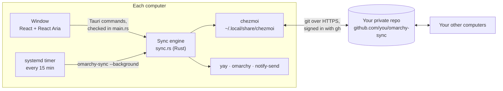

**The pieces**

- **The window** (React, TypeScript and React Aria in [Tauri](https://tauri.app)) shows your settings and sends every action to the engine. Its colours come from your active Omarchy theme, adjusted to meet WCAG contrast.
- **The engine** (`src-tauri/src/sync.rs`, Rust) does the work by running trusted tools: [chezmoi](https://chezmoi.io) for files, `git` and `gh` for your GitHub repository, `pacman` and `yay` for apps, and Omarchy's own `omarchy theme` commands. Everything the window sends is checked first in `src-tauri/src/main.rs`.
- **The background sync** is the same program run by a systemd user timer every 15 minutes (`~/.config/systemd/user/omarchy-sync.timer`).

**A sync, step by step**

1. **Save this computer's changes.** Changed files are copied into the sync folder, new files are added, and everything is saved as one change with a message listing what changed.
2. **Get changes from your other computers** (`git pull --rebase`). If the only clash is in the shared choices file, it's merged automatically. If a real setting clashes, the sync stops and asks you.
3. **Update this computer.** chezmoi writes the incoming files into place, then the theme and background switch over if they changed.
4. **Share with your other computers** (`git push`).
5. **Apps and plugins** that should be here are installed, or wait for your yes.

**Your private repository** holds:

- your settings files, in chezmoi's layout (for example `dot_config/hypr/bindings.lua`);
- `.chezmoidata.yaml`, the shared choices: which folders, apps and plugins sync, the theme and background, and each computer's name, plugins, web apps and personal exceptions;
- `.chezmoiignore`, the rules for what each computer leaves out, worked out per computer from the shared choices;
- `.background/`, the one background image in use.

**How computers are told apart.** Each computer is identified by the first 12 characters of its `/etc/machine-id`, not its hostname, because Omarchy calls every computer "omarchy". Its friendly name is just a label you can change.

**One sync at a time.** A lock file keeps the window and the background timer from syncing at once; a second sync waits for the first to finish.

## Privacy and safety

- Your settings go only to the private repository in your own GitHub account, through GitHub's own sign-in (`gh`). The app has no server, no analytics and no telemetry.
- Before a new computer takes your synced settings, its own are backed up to `~/.local/share/omarchy-sync/backups/`.
- Installing anything asks for your password through Omarchy's prompt (`pkexec`), unless you allowed adding without asking.
- Nothing is deleted on your other computers: switching something off stops syncing it, and Undo and History cover the rest.

**Files on your computer**

| Path                                      | What                                                     |
| ----------------------------------------- | -------------------------------------------------------- |
| `~/.local/share/chezmoi`                  | The sync folder: a local copy of your private repository |
| `~/.local/share/omarchy-sync/backups/`    | Backups taken before a computer's first sync             |
| `~/.local/share/omarchy-sync/background/` | The synced background, on computers that received it     |
| `~/.local/state/omarchy-sync/background`  | The background sync's memory, so it doesn't notify twice |
| `~/.config/systemd/user/omarchy-sync.*`   | The 15-minute timer                                      |

## Questions

**Do I need to know git?** No. Omarchy Sync never shows you git. It's there underneath so every change is kept and can be undone.

**What if I'm offline?** Your changes are kept on this computer and shared the next time you sync with a connection.

**Can I see my synced files?** Yes: **Settings → Open in Browser** opens your private repository on GitHub.

**Will it uninstall apps or delete files?** No. Switching something off only stops syncing it.

**Why is something on one computer missing on another?** Check its switch on that computer (or **Don't Sync on This Computer**), and whether it's waiting on the Sync screen for your yes.

**Is this an official Omarchy project?** No. It's a community app, not affiliated with or endorsed by Omarchy.

## Development

```bash
mise install && mise x -- pnpm install
mise x -- pnpm tauri dev        # the app with live reload
mise x -- pnpm audit:all        # every check CI runs
```

| Layer  | Built with                                                                                                                                     |
| ------ | ---------------------------------------------------------------------------------------------------------------------------------------------- |
| Window | [Tauri 2](https://tauri.app), React 19, TypeScript, [React Aria](https://react-spectrum.adobe.com/react-aria/), Vite                           |
| Engine | Rust, calling chezmoi, git, gh, pacman, yay, systemd and Omarchy's commands                                                                    |
| Checks | Oxlint, Prettier, Knip, dependency-cruiser, Vitest, Playwright with axe accessibility checks, cargo fmt, Clippy, a real two-computer sync test |

The layout, the checks and the writing rules are in [CONTRIBUTING.md](CONTRIBUTING.md). Pull requests are checked by CI, including the page in WebKit with accessibility checks.

## Licence

MIT, see [LICENSE](LICENSE).

## Credits

Built with [Tauri](https://tauri.app), [React](https://react.dev) and [React Aria](https://react-spectrum.adobe.com/react-aria/). File syncing by [chezmoi](https://chezmoi.io). Icons from [Lucide](https://lucide.dev) (ISC). The Omarchy logo belongs to the [Omarchy](https://omarchy.org) project. The [Inter](https://rsms.me/inter/) typeface (SIL Open Font License) stands in for Apple's SF Pro, which may only be used on Apple platforms.
