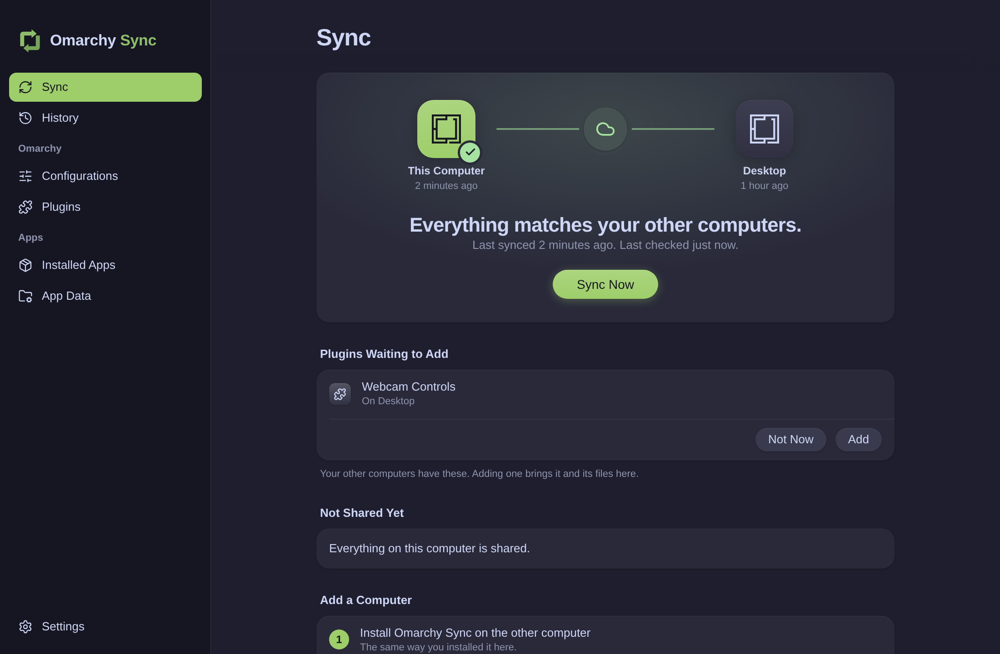

<p align="center">
  
</p>

<h1 align="center">Omarchy Sync</h1>

<p align="center">
  Your <a href="https://omarchy.org">Omarchy</a> settings, themes, plugins and apps, the same on every computer.<br />
  Private to your own GitHub account. One button, or automatic every 15 minutes.
</p>

<p align="center">
  
</p>

## Why Omarchy Sync

- **Your own private space.** Everything syncs through a private `omarchy-sync` repository in your GitHub account. There's no server in between and no account to create. [chezmoi](https://chezmoi.io) does the file work underneath; you never touch it.
- **You choose, item by item.** Keyboard shortcuts, look and feel, night light, Omarchy menu additions, hooks, web apps, terminals, editors: each has its own switch. Apps and plugins can be switched on or off for each computer.
- **Nothing happens behind your back.** New apps and plugins wait for your yes. The Sync screen shows what's about to arrive before it's applied, and every step of a sync as it happens.
- **Every change can be undone.** History lists every sync and exactly which files it changed. Undo shows what it will put back before doing it, on every computer.
- **Built for people, not just terminals.** A native-feeling window that follows your Omarchy theme, with full keyboard and screen reader support.

## What it does

<table>
  <tr>
    <td width="50%"></td>
    <td width="50%"></td>
  </tr>
  <tr>
    <td><b>Configurations.</b> Omarchy and window settings, each with its own switch. Only the theme and background you're using sync, and your other computers switch to them. Your screen layout never syncs, because every screen is different.</td>
    <td><b>Apps and plugins.</b> Choose which go on which computer. They install after you approve them (Omarchy asks for your password), or automatically if you allow it. Switching one off never uninstalls it.</td>
  </tr>
  <tr>
    <td></td>
    <td></td>
  </tr>
  <tr>
    <td><b>History and Undo.</b> Every sync is kept with the files it changed. Undo reverses one change on all your computers.</td>
    <td><b>Three-step setup.</b> Each step says exactly what it will install and do. On a new computer, your current settings are backed up before your synced ones come in.</td>
  </tr>
</table>

Also:

- **Syncs on its own** every 15 minutes through a systemd user timer, even with the window closed. It notifies you only when a choice is needed or syncing fails twice in a row. You can turn this off per computer.
- **When the same setting changed on two computers**, you choose which version to keep. The buttons name the other computer and say when it changed.
- **Web apps travel with their icons**, without the other shortcuts and caches around them.
- **Light and dark**, following your Omarchy theme:

<p align="center"></p>

Not synced: deleting a file or uninstalling an app on one computer (do that on each), browser profiles (use your browser's own sync), and the git history inside plugin folders.

## Install

Omarchy Sync is built from source for now. You need [mise](https://mise.jdx.dev), which Omarchy already includes, and Tauri's system libraries (`webkit2gtk-4.1`, already installed on Omarchy).

```bash
git clone https://github.com/tsubaie/OmaSync.git
cd OmaSync
mise install                      # the Node, pnpm and Rust versions in .mise.toml
mise x -- pnpm install
mise x -- pnpm tauri build --no-bundle
install -Dm755 src-tauri/target/release/omarchy-sync ~/.local/bin/omarchy-sync
install -Dm644 omarchy-sync.desktop ~/.local/share/applications/omarchy-sync.desktop
for size in 16 32 48 64 128 256 512; do
  install -Dm644 packaging/icons/${size}x${size}/omarchy-sync.png \
    ~/.local/share/icons/hicolor/${size}x${size}/apps/omarchy-sync.png
done
```

Then open **Omarchy Sync** from the app launcher. The first run installs the tools it needs, signs you in to GitHub, and then either saves this computer's settings (your first computer) or brings in your synced ones (every other computer, after backing up the current ones to `~/.local/share/omarchy-sync/backups/`).

## Keyboard and accessibility

Every control is reachable with Tab, and the sidebar works with the arrow keys. Shortcuts: **Ctrl+1** to **Ctrl+7** switch sections, **Ctrl+R** or **F5** syncs, **Ctrl+Q** quits. Controls come from [React Aria](https://react-spectrum.adobe.com/react-aria/), so screen readers can use them, and every section is checked against WCAG 2.2 AA in the test suite.

Colours come from your active Omarchy theme and are adjusted to meet WCAG contrast. Animations stop when Hyprland or GNOME animations are turned off.

## Privacy

Your settings go only to the private repository in your own GitHub account, through GitHub's own sign-in (`gh`). The app has no server, no analytics and no telemetry.

## Contributing

See [CONTRIBUTING.md](CONTRIBUTING.md).

## Licence

MIT, see [LICENSE](LICENSE).

## Credits

Built with [Tauri](https://tauri.app), [React](https://react.dev) and [React Aria](https://react-spectrum.adobe.com/react-aria/). Icons from [Lucide](https://lucide.dev) (ISC). The Omarchy logo belongs to the [Omarchy](https://omarchy.org) project; Omarchy Sync is a community app, not affiliated with or endorsed by it. The [Inter](https://rsms.me/inter/) typeface (SIL Open Font License) stands in for Apple's SF Pro, which may only be used on Apple platforms.
